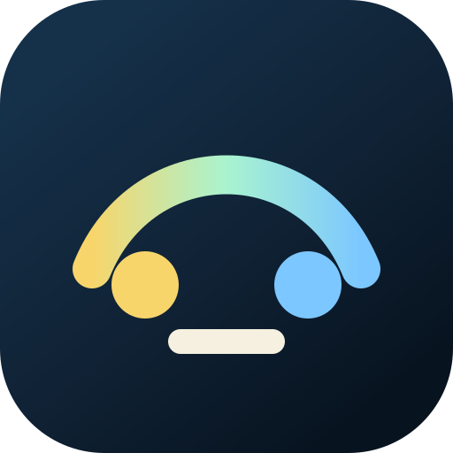
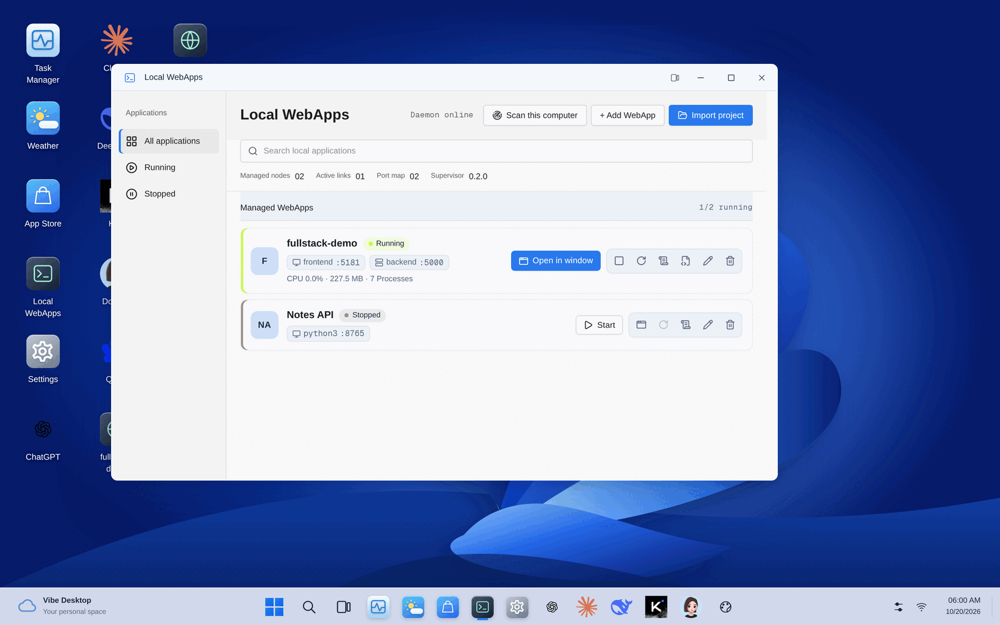

<div align="center">



# Vibe Desktop

**把本机所有前后端分离的项目，放进同一个桌面里管理。**

指向一个项目文件夹，它会找出前端和后端、一起启动、确认都健康，
最后给你一个图标：打开、停止、重启、看日志，都在这里。

[](LICENSE)


[English](README.md) · 简体中文



</div>

## 为什么需要它

一个常见的项目：一个终端跑 Vite 或 Next.js 前端，另一个终端跑 FastAPI 或 Flask 后端，
还得记住好几个端口。再乘上你机器上所有的个人项目、AI WebUI 和内部工具。

Vibe Desktop 把每个这样的项目变成桌面上的一个应用：

- **导入文件夹，得到一个应用。** 自动识别 `web/`、`frontend/`、`client/` … 加
  `server/`、`backend/`、`api/` 这类结构（或根目录的统一启动脚本），先给你看计划，确认后整体注册成一个图标。
- **一起启动，一起停止。** 所有服务在同一个受监管的进程组里运行。任何一个挂了，整组按退避策略一起重启，不会出现「前端在跑、后端已死」的半残状态。
- **启动要验证。** 前端真正能响应才算启动成功；一直起不来就自动撤销注册，不留残留。
- **没有黑箱。** 每个项目都会生成一份可读的 `run.sh` 和 `manifest.json`，在卡片上就能查看。你的源码一个字都不会改。
- **日志分服务看。** 前后端输出在同一个流里，但都带服务名标记，可以只看其中一个。
- **在你工作的地方打开。** 项目在可缩放的桌面窗口里打开，和你的其他网页应用并排；也可以在普通浏览器标签页打开。

## 快速开始

```bash
curl -fsSL 'https://github.com/vimalinx/vibedesktop/releases/latest/download/install-app.sh' | sh
vibedesktop open
```

然后打开 **本地 WebApp → 导入项目**，填项目文件夹，确认识别出的服务，点 **注册并启动**。

更喜欢命令行？

```bash
vibedesktop add ~/Projects/my-app --plan    # 预览会注册什么
vibedesktop add ~/Projects/my-app --start   # 注册、启动、验证健康（失败自动回滚）
vibedesktop scan                            # 列出本机已有的可启动 WebUI
```

AI Agent（Claude Code、Codex 等）通过自带的 `add-app` 技能也能做同样的事：
*“用 add-app 把 ~/Projects/my-webui 加到 Vibe Desktop 并验证。”*

## 支持的技术栈

| | 自动识别 |
| --- | --- |
| **JavaScript** | Next.js · Vite · Vue · Create React App · Astro · SvelteKit · Nuxt · Angular · Gatsby · Remix · SolidStart · Qwik |
| **Python** | FastAPI · Starlette · Flask · Django · Streamlit · Gradio · Chainlit · NiceGUI · Dash · Panel |
| **目录结构** | 单项目、根目录统一启动（Turbo、`concurrently` …）、前端 + 后端子目录 |
| **其他** | 在 **添加 WebApp** 里填命令和端口即可 |

端口从你的配置读取（`vite.config`、`package.json` 脚本等）。前端端口被占用时会自动换一个空闲端口并显式传入；后端端口绝不会被悄悄改掉，因为你的代理配置依赖它。

## 工作原理

```text
 浏览器 ──► Vibe Desktop（Next.js，127.0.0.1） ──►  vibed（进程管理器，127.0.0.1）
                                                      │  令牌认证
                                                      ▼
                                            run.sh  ─┬─ 前端（npm run dev --port …）
                                                     └─ 后端（uvicorn / flask / …）
```

- **Vibe Desktop**：网页桌面和接口，只监听本机回环地址。
- **vibed**：负责进程监管、健康检查、资源统计和日志，只接受携带私有令牌的请求。
- **run.sh**：每个项目一份，生成在 `~/.local/share/vibedesktop/managed-apps/`。

## 稳定、安全、省心

| | |
| --- | --- |
| **只在本机** | 只监听 127.0.0.1，拒绝其他主机名的请求，防住 DNS 重绑定攻击；拒绝跨站写入。没有账号、没有遥测、不上云。 |
| **安全更新** | 每次安装或更新都先在独立目录构建、健康检查，再原子切换。新版本起不来自动回到上一版；`vibedesktop rollback` 不需要联网。 |
| **崩溃隔离** | 某个窗口出错只显示一张可恢复的卡片，不会让整个桌面白屏。访问 `/?safe=1` 可以不恢复上次的窗口启动。 |
| **数据可靠** | 配置写入时先落盘同步，并保留上一份完好的副本。断电导致文件损坏时，坏文件另存、自动用上一份恢复，不会因此启动失败。 |
| **轻量** | 安装后的版本约 85 MB：精简的独立服务端，不含编译器、构建缓存和开发依赖。只保留当前版本和一个回滚版本。 |

## 系统要求

支持 systemd 用户服务的 Linux、`git`、Node.js 20 及以上（没有的话安装器会自动下载固定版本）。导入项目需要 Python 3。
首次安装会从源码构建：大约几分钟，需要约 1 GB 临时磁盘空间。

## 常用命令

```bash
vibedesktop open | status | logs
vibedesktop start | stop | restart
vibedesktop add <目录> [--plan | --start] [--name 名称]
vibedesktop scan
vibedesktop update      # 拉取最新版本、构建、切换、健康检查，失败自动回滚
vibedesktop rollback    # 回到上一个版本，不需要联网
vibedesktop uninstall   # 默认保留数据；加 --purge-data --confirm-purge-data 才会删除

vibed status | logs | update | rollback
```

<details>
<summary>文件都放在哪</summary>

| 内容 | 路径 |
| --- | --- |
| 应用版本 | `~/.local/share/vibedesktop/app/releases/` |
| 生成的项目启动包 | `~/.local/share/vibedesktop/managed-apps/` |
| 桌面数据、应用目录、备份 | `~/.local/state/vibedesktop/` |
| vibed 配置 | `~/.config/vibed/` |
| vibed 状态和日志 | `~/.local/state/vibed/` |
| vibed 连接信息（令牌、端口） | `$XDG_RUNTIME_DIR/vibed/` |

所有路径都遵循 `XDG_*` 环境变量。更新从不改动配置和数据。

</details>

<details>
<summary>安装选项</summary>

安装器会从 3000 到 3010 选第一个空闲端口。用 `curl … | sh -s -- --port 3002` 指定端口，
`--tag v0.2.1` 指定版本，`--repo <url>` 从自己的 fork 安装。

在反向代理或 SSH 端口转发后面使用？把 `VIBE_PUBLIC_ORIGIN` 设成浏览器地址栏里的精确地址（真实域名需要 HTTPS）。

</details>

## 不只是进程管理器

Vibe Desktop 同时也是一个完整的网页桌面：窗口可以分屏、平铺，可以保存工作场景，有程序坞、网页应用商店、壁纸和主题、Windows 11 和 macOS 风格外壳、带恢复预览的备份，以及一套带版本号的 [`/api/v1` 协议](docs/protocol/v1.md)，可以用来做你自己的桌面前端。详见[使用指南](docs/guide.md)。

## 开发

```bash
npm install
npm run dev          # 桌面运行在 http://localhost:3000
npm run daemon       # 从源码运行 vibed（另开一个终端）
npm test && npm run test:e2e
```

参见 [CONTRIBUTING.md](CONTRIBUTING.md) 和[发布流程](docs/releasing.md)。

## 许可证

Copyright 2026 Vimalinx。基于 [Apache License 2.0](LICENSE) 开源：个人和商业使用、修改、再分发都可以。产品源码边界见 [OPEN_SOURCE.md](OPEN_SOURCE.md)，依赖许可证见 [THIRD_PARTY_NOTICES.md](THIRD_PARTY_NOTICES.md)。
